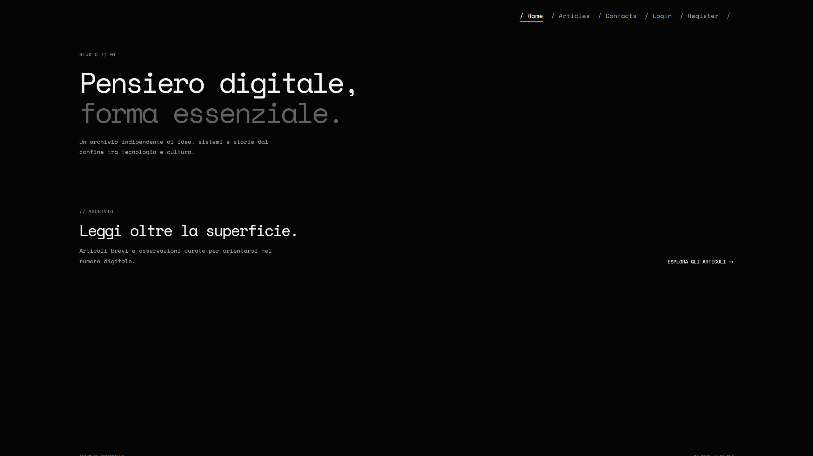
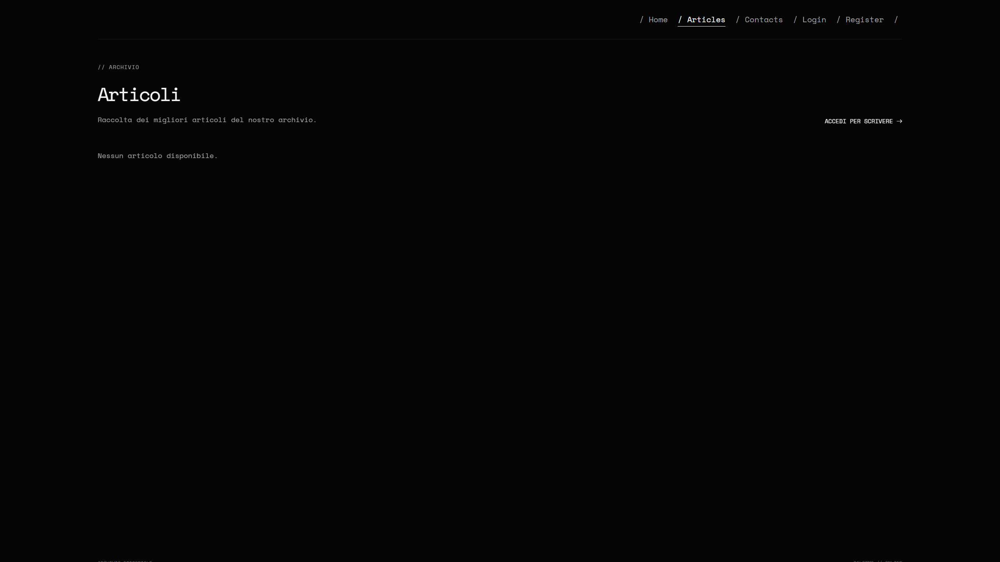
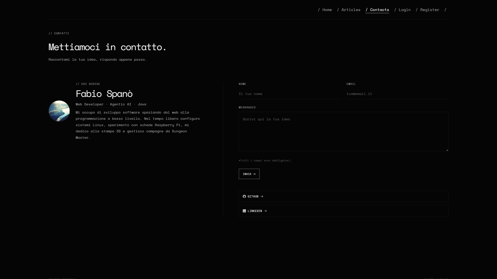
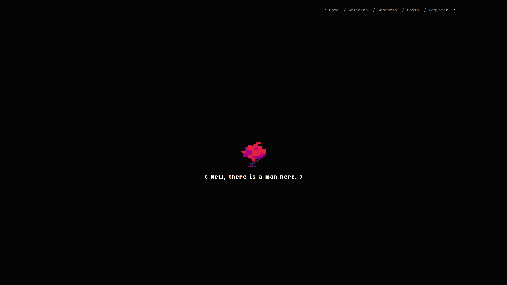

# editorial-blog



Multi-page editorial blog built with Laravel: defined routes with dedicated controllers and content rendered through reusable Blade templates with a shared layout. The archive section lists published articles, each with a dedicated detail page. Publishing is reserved for registered authors: authenticated accounts can create, edit, and delete articles, while public visitors have read-only access. Articles are stored in the database with a title, author, category, text body, and an uploaded cover image. A contact section collects messages through a validated form that delivers notification emails to the local log in development. An automated test suite covers the primary route flows.

## Screenshots






## Installation and setup

```bash
composer setup
npm run dev
```

Or manually:

```bash
composer install
cp .env.example .env
php artisan key:generate
php artisan migrate
php artisan storage:link
npm install
npm run build
php artisan serve
```
